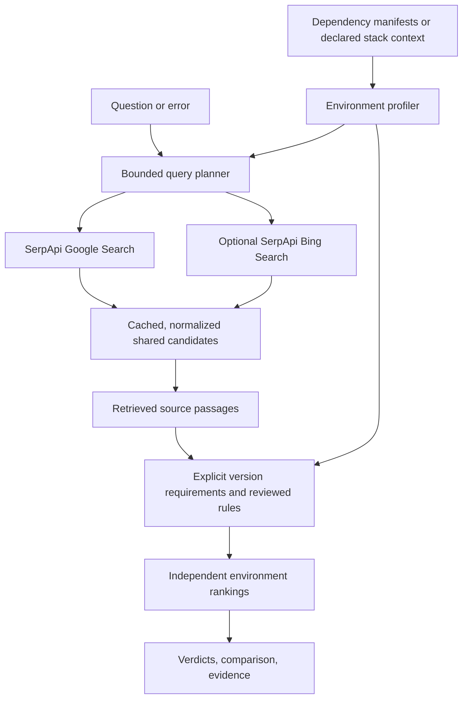

# VersionVerdict (Winner - Open Innovation Track, SerpApi India Hackathon 2026)

**The right answer for your version.**

*Repository-aware developer search powered by SerpApi.*

VersionVerdict searches technical sources against a declared software or hardware environment. Use a manifest or describe a stack explicitly: firmware, toolchains, runtimes, frameworks, and libraries. Compare two environments against **the same retrieved candidates** and inspect the evidence behind each verdict.

**One question. Different dependency versions. Different verdicts.**

## The problem

A technically correct answer can still be wrong for your project. For example, Pydantic V1 uses `parse_obj()` to validate dictionary data. Pydantic V2 introduces `model_validate()` and deprecates the older method. SQLAlchemy 1.4 retains legacy `Engine.execute()` behavior, while 2.0 removes that API.

VersionVerdict separates search relevance from applicability. A good search position, recent publication date, or convincing snippet cannot establish compatibility.

## What the application does

- Reads Python, JavaScript, Rust, Go, and PlatformIO manifests, or an explicit `environment.json` for any technology stack. Exact declared pins stay separate from ranges and unresolved declarations.
- Plans two Google searches: the developer's question and a bounded version/requirements query for the selected technology.
- Optionally adds one SerpApi Bing Search request for supplementary discovery.
- Normalizes and deduplicates candidates, then retrieves bounded source content over HTTPS.
- Extracts explicit version requirements from relevant source passages; reviewed Python recipe rules also use pinned migration facts.
- Classifies supported recipes conservatively and ranks a shared candidate set independently for each environment.
- Provides a terminal-style React workspace with manual stack context, manifest previews, keyboard shortcuts, version comparisons, inspectable evidence, and four persisted color themes.
- Exports investigation reports as JSON or Markdown, with declared context, retrieval provenance, verdicts, and supporting source quotes.
- Uses a persistent SQLite cache and local request-attempt allocation to reduce repeated searches on a shared account.

It does not execute uploaded repository code, generate fixes with an LLM, or infer installed dependencies from manifest declarations.

| Verdict | Meaning |
|---|---|
| `COMPATIBLE` | Evidence supports a reviewed recipe or explicit version requirement for this declared context. |
| `WRONG_VERSION` | Evidence establishes a version contradiction for the scoped recipe or requirement. |
| `STALE` | The recipe is deprecated or superseded in this environment; old advice is not rejected merely for being old. |
| `UNCERTAIN` | Version, namespace, runtime conditions, or source evidence cannot establish applicability. |

## The defining demonstration

Ask **“Validate a dictionary into a Pydantic model.”**

| Recognized recipe | `pydantic==1.10.15`, native API | `pydantic==2.9.2`, native API |
|---|---|---|
| `parse_obj()` | `COMPATIBLE` | `STALE` |
| `model_validate()` | `WRONG_VERSION` | `COMPATIBLE` |

Change the dependency version while keeping the candidates fixed. The preferred recipe changes for a documented reason. Pydantic V2 retains deprecated method names, so `parse_obj()` is labelled stale rather than removed.

The second comparison asks **“Execute a SQL statement with SQLAlchemy.”** `Engine.execute()` is stale in SQLAlchemy 1.4 legacy mode and unavailable in 2.0. Replacement advice must identify `Connection.execute()` and the relevant statement context; ambiguous or incomplete recipes remain uncertain.

The bundled search-result fixtures are **illustrative, not captured SerpApi responses**. They provide an offline product demonstration and consume no searches. Live mode requires a backend key and working network access. Live responses reused by the application are labelled cached.

Trusted authored version witnesses reproduce selected API behavior in isolated, pinned environments. They do not execute retrieved web snippets and do not prove arbitrary solutions safe for a user's application.

## How it works



### Environment and evidence boundaries

Each profile accepts up to two manifests and 256 KiB combined. Supported filenames are `requirements.txt`, `pyproject.toml`, `package.json`, `Cargo.toml`, `go.mod`, `platformio.ini`, and `environment.json`. The profiler does not install packages or resolve manifests. A range is preserved as a range, not resolved to a fictional installed version. Markers, conditional build declarations, duplicates, workspace dependencies, and unsupported directives produce warnings or unknown versions.

For a stack without a supported manifest format, use the manual context editor or provide `environment.json`. For example:

```json
{
  "technology": "FreeRTOS",
  "language": "C",
  "platform": "bare metal",
  "hardware": "STM32F407",
  "dependencies": [
    {"name": "FreeRTOS", "version": "11.1.0"},
    {"name": "arm-none-eabi-gcc", "version": "13.2.1"}
  ],
  "notes": "Static allocation enabled; Cortex-M4 target."
}
```

`version` declares an exact value; `constraint` declares a range instead. Omit both when unknown. These are user declarations, not measured runtime facts. Hardware, platform, and notes are preserved for inspection; they are not a hardware or ABI validator.

General search accepts any technology name. Its deterministic evidence matcher supports a limited grammar of explicit, named version requirements in relevant passages. It does not claim to understand every API, firmware configuration, or version scheme; unresolved or qualified conditions remain uncertain. A compatible version requirement is not proof that an entire proposed solution will work.

The deeper reviewed recipe rules cover Pydantic `parse_obj()` / `model_validate()` and SQLAlchemy `Engine.execute()` / `Connection.execute()`. Their reviewed version windows are Pydantic 1.10 and 2.0–2.14, and SQLAlchemy 1.4 and 2.0. Prerelease, development, post-release, local, and unsupported versions remain uncertain in these rules. Pydantic native versus `pydantic.v1` namespace and SQLAlchemy 1.4 future mode are explicit context, not guessed from the query. The V1 shim namespace is available only from Pydantic 1.10.17 onward.

Reviewed recipe fetching retains its official documentation boundary. General evidence fetching permits public HTTPS pages, rejects private/local addresses and credentials, validates redirects, and pins checked DNS addresses. Fetches have time, size, and concurrency bounds. Network policies or anti-bot protection can prevent source inspection; a snippet cannot substitute for that missing evidence. HTML code blocks are parsed without execution alongside their surrounding section. One page can produce separate recipe cards. Evidence carries its section, document hash, and fetch timestamp. Reviewed migration evidence is a hash-verified pinned official snapshot, labelled `reviewed_snapshot`; it is not fetched live during each search.

Ranking prioritizes `COMPATIBLE`, then `UNCERTAIN`, `STALE`, and `WRONG_VERSION`. General results use bounded target and question-term matches in titles, snippets, and URLs within these verdict groups; inspectable ranking reasons distinguish these metadata signals from source evidence. Rank scores are ordering signals, not probabilities of factual correctness.

## SerpApi engines and resources

| Engine | Actual role | Default |
|---|---|---|
| **Google Search API** — `engine=google` | Technical source discovery using the question and official-documentation query | Enabled |
| **Bing Search API** — `engine=bing` | One supplementary query for a different result set | Opt-in |

Both use `https://serpapi.com/search.json` through async HTTPX. The backend consumes structured organic titles, URLs, snippets, and positions. Documentation fetches are ordinary HTTP requests, not a separate SerpApi engine. SDKs and agent Search Tools are integration choices, not engines used by this repository.

Requests have bounded concurrency, timeouts, and one retry for eligible transport or server failures. Authentication, quota, and provider errors are surfaced. Source evidence is required regardless of which engine discovered a candidate.

Useful official resources:

- [Google Search API reference](https://serpapi.com/search-api) and [Bing Search API reference](https://serpapi.com/bing-search-api): request and response contracts.
- [API Playground](https://serpapi.com/playground): inspect real responses before recording a live demo.
- [Integrations](https://serpapi.com/integrations) and [Python SDK](https://serpapi.com/integrations/python): official integration guidance; the application currently retains its async HTTPX adapter.
- [Search Tools](https://serpapi.github.io/serpapi-search-tools-python/): agent tooling reference; not an application dependency.
- [Blog](https://serpapi.com/blog/) and [BuiltWithSerpApi](https://serpapi.github.io/BuiltWithSerpApi/): examples and prior art.

**Live verification status:** a genuine Google submission for a declared FreeRTOS context returned 18 deduplicated candidates. Its receipt records three HTTP attempts, including a retry; an identical repeat reused both cached searches with zero new calls and an unchanged candidate pool. All results remained uncertain because general source evidence was unavailable in the restricted cloud environment. This verifies retrieval and conservative failure behavior, not firmware compatibility. Optional Bing has not been live-verified here. Inspect the [verification record](docs/live-verification.json) and [sanitized genuine response](fixtures/live/2026-10-10-freertos-google.json); illustrative fixtures remain separate.

That capture exposed unrelated results for loose platform terms. The final planner keeps the broad query focused on the named technology and groups version alternatives. An [offline replay](docs/live-ranking-replay.json) of the original candidates now places three FreeRTOS notification sources first without changing any verdict. The revised planner has unit coverage; it has not consumed another live search for verification.

### Using a shared 250-search account wisely

The default application allocation is **50 request attempts**, configured by `SERPAPI_REQUEST_BUDGET`. It counts HTTP attempts, including failures, rather than reporting billed search credits or the account's remaining balance. This local safeguard leaves room in a shared account for teammates, experiments, and the final recording.

An uncached submission plans **two Google requests**, or **three requests with Bing enabled**. Retries reserve additional attempts. Identical generated searches reuse the 24-hour response cache. Both environments share one retrieval pool; they do not run separate searches. Changing a general stack's version or platform can change a targeted query and require a new request, while the reviewed examples reuse their stable queries. Refresh bypasses the cache and consumes attempts. Source fetches, offline fixtures, unit tests, evaluation, and trusted version witnesses do not spend SerpApi searches.

Keep the persistent cache and ledger. Separate deployments have separate local allocations even when they use the same account; check the account dashboard for actual shared usage. The application never fabricates an account-remaining balance.

## Technology

Python 3.12+, FastAPI, Pydantic, HTTPX, `packaging`, `tomllib`, Beautiful Soup, and SQLite on the backend; React, TypeScript, and Vite on the frontend. Tests use pytest and HTTPX mocks. One FastAPI process can serve the built application.

## Getting started

Prerequisites: Python 3.12+, Node.js 22+, and npm. A SerpApi key is needed only for live searches.

From the repository root:

```bash
python3.12 -m venv .venv
.venv/bin/python -m pip install -r backend/requirements-lock.txt
npm --prefix frontend ci
./scripts/start_preview.sh
```

The launcher builds the frontend and serves both the interface and API on **port 3000**, bound to `0.0.0.0` so a development host can forward the port. It makes no search requests at startup. Open <http://127.0.0.1:3000>. API documentation: <http://127.0.0.1:3000/docs>. Set `PORT` to change the combined service port.

### Windows PowerShell (including Zed's terminal)

Run these commands from the repository root. `py -3.12` requires Python 3.12 to be installed; check available versions with `py -0p`. The virtual environment's Python is called directly, so activation is unnecessary.

```powershell
py -3.12 -m venv .venv
.\.venv\Scripts\python.exe -m pip install -r backend\requirements-lock.txt
npm --prefix frontend ci
npm --prefix frontend run dev
```

Leave Vite running. In a second PowerShell terminal, also at the repository root:

```powershell
.\.venv\Scripts\python.exe -m uvicorn app.main:app --app-dir backend --reload --port 3000
```

Open <http://127.0.0.1:5173>. Vite forwards `/api` to port 3000. If you previously started Uvicorn on port 8000, stop that process with `Ctrl+C` before starting this command. A root `.env` file is loaded by the backend on startup; restart Uvicorn after editing it. Keep `.env` out of Git and revoke any key pasted into a chat or public log.

If the Python launcher cannot find 3.12 and Anaconda is installed, use the Conda setup already supported by the application:

```powershell
conda create -n versionverdict python=3.12 -y
conda run -n versionverdict python -m pip install -r backend\requirements-lock.txt
conda run --no-capture-output -n versionverdict python -m uvicorn app.main:app --app-dir backend --reload --port 3000
```

Skip environment creation on later runs. Keep `npm --prefix frontend run dev` running in a second terminal.

The cloud environment onboarding screen does not provide an embedded web preview. A running process there does not create a public deployment URL. Use a host's port-forwarding facility or the [deployment guide](docs/deployment.md); the committed screenshots show the tested interface.

If the interface cannot load its JavaScript, the page displays startup instructions. If the backend is unavailable, the rendered workspace shows an API error and a retry action. Missing assets return 404 instead of an HTML response, and the entry page is revalidated after builds.

For frontend development, keep the combined service on port 3000 and, in another terminal:

```bash
npm --prefix frontend run dev
```

Vite proxies `/api` to port 3000. Press `/` outside a form field to focus the question. `Ctrl+Enter` (or `Cmd+Enter`) submits through the same validation as the live-search button. Keyboard shortcuts do not bypass missing-key or manifest checks.

### Configure live mode

The backend reads process environment variables and loads a root `.env` file if present. Existing process variables take precedence. For this cloud workspace, add your key to the existing `SERPAPI_KEY` secret in the environment settings. For local Bash, you can enter the key privately before starting the backend:

```bash
read -rsp 'SerpApi key: ' SERPAPI_KEY
export SERPAPI_KEY
printf '\n'
export SERPAPI_REQUEST_BUDGET=50
export VERSIONVERDICT_CACHE_DIR=.cache/versionverdict
```

Restart the backend after changing its environment. SerpApi authentication goes only to `serpapi.com`. Source inspection also needs outbound HTTPS to the retrieved public documentation hosts. A restricted cloud proxy can block general source fetching, including connections to validated IP addresses; the backend then preserves uncertainty. Never put the key in a frontend `VITE_*` variable, log, or commit. See [the API-key security boundary](docs/security.md) for exactly where it is sent and who must be trusted to run the backend.

### Use the comparison page

1. Enter a technology and provide a manifest or manual stack context. Optional Pydantic and SQLAlchemy demos remain available.
2. Enter a question. Enable comparison when evaluating an upgrade, and declare each environment independently.
3. Choose live retrieval or the clearly labelled illustrative fixture. Leave supplementary Bing off unless you need additional discovery.
4. Submit and inspect verdicts over the same candidates. Open supporting evidence and inspect uncertainty before applying advice.
5. Select a comfortable theme and download an evidence report for a pull request, issue, or teammate.

`POST /api/search` accepts these multipart fields:

| Fields | Values |
|---|---|
| `query`, `library` | Question of 3–240 characters; any technology label of 1–80 characters |
| `mode` | `live` or `recorded` (`recorded` is the illustrative fixture) |
| `left_file`, `left_extra_file` | Required primary manifest and optional second manifest for A |
| `right_file`, `right_extra_file` | Optional primary and second manifests for B |
| `left_pydantic_api_mode`, `right_pydantic_api_mode` | `native`, `v1_shim`, or `unknown` |
| `left_sqlalchemy_future`, `right_sqlalchemy_future` | `true`, `false`, or `unknown` |
| `include_secondary`, `refresh` | Boolean; add Bing or bypass the response cache |
| `left_name`, `right_name` | Optional profile labels |

`GET /api/health` reports configuration and application health without returning the key. See the generated `/docs` schema for complete request and response schemas.

## Verification

```bash
PYTHONPATH=backend .venv/bin/python -m pytest backend/tests -q
npm --prefix frontend run build
.venv/bin/python scripts/verify_versions.py --output fixtures/witnesses/report.json
PYTHONPATH=backend .venv/bin/python scripts/evaluate.py --output fixtures/evaluation/report.json
```

The version-witness runner creates isolated environments under `/tmp/versionverdict-witness-venvs` and installs its four explicitly pinned dependency versions. After the first successful installation, pass `--no-install` to repeat without package downloads. It runs trusted snippets authored in this repository, never uploaded code or fetched web recipes.

The curated evaluation tests specific supported boundaries and conservative failure cases. It is not a benchmark of general web-search accuracy. Inspect [evaluation notes](docs/evaluation.md) and the generated reports before quoting measured results.

Run the explicit live test only after configuring a backend key and network access; it spends requests:

```bash
RUN_LIVE_SERPAPI=1 PYTHONPATH=backend .venv/bin/python -m pytest backend/tests/test_live.py -q
```

The CI workflow checks backend tests and the frontend production build without an API key. The live test is explicitly skipped in that environment.

## Limitations

- Manifest declarations do not prove installed versions, active import namespaces, or runtime settings.
- Any declared technology can be searched. Detailed recipe reasoning remains narrower than stack coverage; generic explicit requirements do not prove arbitrary code compatible.
- SQLAlchemy recipe applicability depends on statement and transaction conditions as well as version.
- A definitive verdict requires supported source evidence; insufficient or contradictory content remains uncertain.
- Search and documentation may change. Bundled illustrative results are not live captures.
- Witnesses establish the behavior of their exact trusted examples, not every retrieved answer or a user's repository.
- Google retrieval and cache reuse were verified; general source inspection is blocked by this cloud's restrictive proxy. Optional Bing and a public deployment remain unverified here.

## Hackathon submission

**Event:** SerpApi India Hackathon 2026 · **Track:** Open Innovation — Developer Tools

- **Engines:** Google Search; optional Bing Search. 
- **Contributor:** Ananay Srivastava ([Ananay28425](https://github.com/Ananay28425)).
- **AI-assisted development:** Codex supported planning and implementation. Source-backed rules, automated tests, and recorded version witnesses provide the validation evidence.
- **Video and deployment:** Follow the [three-minute demo guide](https://www.youtube.com/watch?v=c6cLaC6NtF4).
- **License:** not specified yet.

**VersionVerdict — The right answer for your version.**
