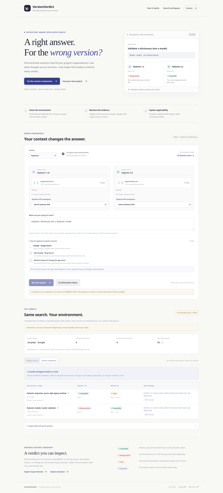
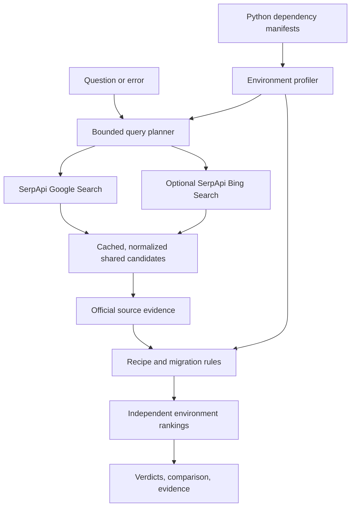

# VersionVerdict

**The right answer for your version.**

*Repository-aware developer search powered by SerpApi.*

VersionVerdict finds technical sources and checks a narrow set of recognized Python recipes against dependencies declared in a project. Compare two environments against **the same retrieved candidates** and inspect why their rankings change.

**One question. Different dependency versions. Different verdicts.**

[Source code](https://github.com/Ananay28425/VersionVerdict) · [Demo guide](docs/demo.md) · [Deployment](docs/deployment.md) · [Evaluation](docs/evaluation.md)

Demo video and public deployment URLs are not yet published.

[Desktop screenshot](docs/screenshots/desktop.png) · [Mobile screenshot](docs/screenshots/mobile.png)

<details>
<summary>View the tested Pydantic comparison</summary>



</details>

## The problem

A technically correct answer can still be wrong for your project. For example, Pydantic V1 uses `parse_obj()` to validate dictionary data. Pydantic V2 introduces `model_validate()` and deprecates the older method. SQLAlchemy 1.4 retains legacy `Engine.execute()` behavior, while 2.0 removes that API.

VersionVerdict separates search relevance from applicability. A good search position, recent publication date, or convincing snippet cannot establish compatibility.

## What the application does

- Reads `requirements.txt` and `pyproject.toml` safely, distinguishing exact declared pins from ranges and unresolved declarations.
- Plans two Google searches: the developer's question and a bounded official-documentation query covering the migration boundary.
- Optionally adds one Bing search for supplementary discovery, rather than silently falling back to another engine.
- Normalizes and deduplicates candidates, then fetches allowlisted official documentation for evidence.
- Extracts scoped recipe evidence and combines it with reviewed, pinned migration facts.
- Classifies supported recipes conservatively and ranks a shared candidate set independently for each environment.
- Shows dependency context, verdicts, explanations, inspectable source evidence, and retrieval provenance in a functional React comparison page.
- Uses a persistent SQLite cache and local request-attempt allocation to reduce repeated searches on a shared account.

It does not execute uploaded repository code, generate fixes with an LLM, or infer installed dependencies from manifest declarations.

| Verdict | Meaning |
|---|---|
| `COMPATIBLE` | Evidence supports the recognized recipe for this declared version and confirmed context. |
| `WRONG_VERSION` | Evidence establishes that the recipe is unavailable in this version or mode. |
| `STALE` | The recipe is deprecated or superseded in this environment; old advice is not rejected merely for being old. |
| `UNCERTAIN` | Version, namespace, runtime conditions, or source evidence cannot establish applicability. |

## The defining demonstration

Ask **“Validate a dictionary into a Pydantic model.”**

| Recognized recipe | `pydantic==1.10.15`, native API | `pydantic==2.9.2`, native API |
|---|---|---|
| `parse_obj()` | `COMPATIBLE` | `STALE` |
| `model_validate()` | `WRONG_VERSION` | `COMPATIBLE` |

Change the dependency version while keeping the candidates fixed. The preferred recipe changes for a documented reason. Pydantic V2 retains deprecated method names, so `parse_obj()` is labelled stale rather than removed.

The second comparison asks **“Execute a SQL statement with SQLAlchemy.”** `Engine.execute()` is stale in SQLAlchemy 1.4 legacy mode and unavailable in 2.0. Replacement advice must identify `Connection.execute()` and the relevant statement context; ambiguous or incomplete recipes remain uncertain.

The bundled search-result fixtures are **illustrative, not captured SerpApi responses**. They provide an offline product demonstration and consume no searches. Live mode requires a backend key and working network access. Live responses reused by the application are labelled cached.

Trusted authored version witnesses reproduce selected API behavior in isolated, pinned environments. They do not execute retrieved web snippets and do not prove arbitrary solutions safe for a user's application.

## How it works



### Environment and evidence boundaries

Each profile accepts up to two manifests and 256 KiB combined. The profiler reads PEP 621 dependencies and a limited subset of Poetry declarations. A range is preserved as a range, not resolved to a fictional installed version. Markers without target context, duplicate declarations, unsupported directives, and direct URLs produce warnings or unknown versions.

Rules are intentionally limited to Pydantic `parse_obj()` / `model_validate()` and SQLAlchemy `Engine.execute()` / `Connection.execute()`. The reviewed version windows are Pydantic 1.10 and 2.0–2.14, and SQLAlchemy 1.4 and 2.0. Prerelease, development, post-release, local, and unsupported versions remain uncertain. Pydantic native versus `pydantic.v1` namespace and SQLAlchemy 1.4 future mode are explicit context, not guessed from the query. The V1 shim namespace is available only from Pydantic 1.10.17 onward.

Only `docs.pydantic.dev`, the canonical `pydantic.dev/docs/validation/` path, and `docs.sqlalchemy.org` are fetched for live recipe evidence. Fetches have time and size bounds. At most two redirects are followed, with every target checked against the official documentation boundary. Other hosts may contribute search candidates, but do not receive definitive labels without supported evidence. HTML code blocks are parsed for the supported APIs without execution, alongside their surrounding section. One page can produce separate recipe cards. Recipe evidence carries its section, full-document hash, and fetch timestamp. The separate migration evidence is a hash-verified pinned official snapshot, labelled `reviewed_snapshot`; it is not fetched live during each search.

Ranking prioritizes `COMPATIBLE`, then `UNCERTAIN`, `STALE`, and `WRONG_VERSION`, with evidence and original result position used for ordering. Rank scores are ordering signals, not probabilities of factual correctness.

## SerpApi engines and resources

| Engine | Actual role | Default |
|---|---|---|
| **Google Search API** — `engine=google` | Technical source discovery using the question and official-documentation query | Enabled |
| **Bing Search API** — `engine=bing` | One supplementary query for a different result set | Opt-in |

Both use `https://serpapi.com/search.json` through async HTTPX. The backend consumes structured organic titles, URLs, snippets, and positions. Documentation fetches are ordinary HTTP requests, not a separate SerpApi engine. SDKs and agent Search Tools are integration choices, not engines used by this repository.

Requests have bounded concurrency, timeouts, and one retry for eligible transport or server failures. Authentication, quota, and provider errors are surfaced. Source evidence is required regardless of which engine discovered a candidate.

Useful official resources:

- [Google Search API reference](https://serpapi.com/search-api) and [Bing Search API reference](https://serpapi.com/bing-search-api): request and response contracts.
- [API Playground](https://serpapi.com/playground): inspect real responses before recording a live demo.
- [Integrations](https://serpapi.com/integrations) and [Python SDK](https://serpapi.com/integrations/python): official integration guidance; the application currently retains its async HTTPX adapter.
- [Search Tools](https://serpapi.github.io/serpapi-search-tools-python/): agent tooling reference; not an application dependency.
- [Blog](https://serpapi.com/blog/) and [BuiltWithSerpApi](https://serpapi.github.io/BuiltWithSerpApi/): examples and prior art.

**Live verification status:** a successful live end-to-end Google or Bing run has not been verified in the development cloud environment. Do not cite the illustrative fixtures as proof of live search.

### Using a shared 250-search account wisely

The default application allocation is **50 request attempts**, configured by `SERPAPI_REQUEST_BUDGET`. It counts HTTP attempts, including failures, rather than reporting billed search credits or the account's remaining balance. This local safeguard leaves room in a shared account for teammates, experiments, and the final recording.

An uncached submission plans **two Google requests**, or **three requests with Bing enabled**. Retries reserve additional attempts. Repeating the same search or changing only dependency context reuses the 24-hour response cache. Refresh bypasses it and consumes attempts. Source fetches, offline fixtures, unit tests, evaluation, and trusted version witnesses do not spend SerpApi searches.

Keep the persistent cache and ledger. Separate deployments have separate local allocations even when they use the same account; check the account dashboard for actual shared usage. The application never fabricates an account-remaining balance.

## Technology

Python 3.12+, FastAPI, Pydantic, HTTPX, `packaging`, `tomllib`, Beautiful Soup, and SQLite on the backend; React, TypeScript, and Vite on the frontend. Tests use pytest and HTTPX mocks. One FastAPI process can serve the built application.

## Getting started

Prerequisites: Python 3.12+, Node.js 22+, and npm. A SerpApi key is needed only for live searches.

From the repository root:

```bash
python3.12 -m venv .venv
.venv/bin/python -m pip install -r backend/requirements-lock.txt
npm --prefix frontend ci
npm --prefix frontend run build
PYTHONPATH=backend .venv/bin/uvicorn app.main:app --host 127.0.0.1 --port 8000 --workers 1
```

Open <http://127.0.0.1:8000>. API documentation: <http://127.0.0.1:8000/docs>.

For frontend development, run the backend and, in another terminal:

```bash
npm --prefix frontend run dev
```

### Configure live mode

The application reads process environment variables; it does not automatically load `.env`. The template [.env.example](.env.example) documents the supported values. In Bash, enter the key privately before starting the backend:

```bash
read -rsp 'SerpApi key: ' SERPAPI_KEY
export SERPAPI_KEY
printf '\n'
export SERPAPI_REQUEST_BUDGET=50
export VERSIONVERDICT_CACHE_DIR=.cache/versionverdict
```

Restart the backend after changing its environment. Allow outbound HTTPS to `serpapi.com`, `docs.pydantic.dev`, `pydantic.dev`, and `docs.sqlalchemy.org`. Never put the key in a frontend `VITE_*` variable, log, or commit.

### Use the comparison page

1. Load a Pydantic or SQLAlchemy preset, or upload named `requirements.txt` / `pyproject.toml` files.
2. Enter a question and confirm the relevant API namespace or future-mode context independently for each environment.
3. Choose live retrieval or the clearly labelled illustrative fixture. Leave supplementary Bing off unless you need additional discovery.
4. Submit and compare verdicts over the same candidates. Open supporting evidence and inspect uncertainty before applying advice.

`POST /api/search` accepts these multipart fields:

| Fields | Values |
|---|---|
| `query`, `library` | Question of 3–240 characters; `pydantic` or `sqlalchemy` |
| `mode` | `live` or `recorded` (`recorded` is the illustrative fixture) |
| `left_file`, `left_extra_file` | Required primary manifest and optional second manifest for A |
| `right_file`, `right_extra_file` | Optional primary and second manifests for B |
| `left_pydantic_api_mode`, `right_pydantic_api_mode` | `native`, `v1_shim`, or `unknown` |
| `left_sqlalchemy_future`, `right_sqlalchemy_future` | `true`, `false`, or `unknown` |
| `include_secondary`, `refresh` | Boolean; add Bing or bypass the response cache |
| `left_name`, `right_name` | Optional profile labels |

`GET /api/health` reports configuration and application health without returning the key. See the generated `/docs` schema for complete request and response schemas.

## Verification

```bash
PYTHONPATH=backend .venv/bin/python -m pytest backend/tests -q
npm --prefix frontend run build
.venv/bin/python scripts/verify_versions.py --output fixtures/witnesses/report.json
PYTHONPATH=backend .venv/bin/python scripts/evaluate.py --output fixtures/evaluation/report.json
```

The version-witness runner creates isolated environments under `/tmp/versionverdict-witness-venvs` and installs its four explicitly pinned dependency versions. After the first successful installation, pass `--no-install` to repeat without package downloads. It runs trusted snippets authored in this repository, never uploaded code or fetched web recipes.

The curated evaluation tests specific supported boundaries and conservative failure cases. It is not a benchmark of general web-search accuracy. Inspect [evaluation notes](docs/evaluation.md) and the generated reports before quoting measured results.

Run the explicit live test only after configuring a backend key and network access; it spends requests:

```bash
RUN_LIVE_SERPAPI=1 PYTHONPATH=backend .venv/bin/python -m pytest backend/tests/test_live.py -q
```

The CI workflow checks backend tests and the frontend production build without an API key. The live test is explicitly skipped in that environment.

## Limitations

- Manifest declarations do not prove installed versions, active import namespaces, or runtime settings.
- Four recognized API patterns in two libraries are covered; this is not broad framework compatibility analysis.
- SQLAlchemy recipe applicability depends on statement and transaction conditions as well as version.
- A definitive verdict requires supported source evidence; insufficient or contradictory content remains uncertain.
- Search and documentation may change. Bundled illustrative results are not live captures.
- Witnesses establish the behavior of their exact trusted examples, not every retrieved answer or a user's repository.
- Live integration and a public deployment remain unverified here.

## Hackathon submission

**Event:** SerpApi India Hackathon 2026 · **Track:** Open Innovation — Developer Tools

- **Engines:** Google Search; optional Bing Search. Claim successful live usage only after explicitly testing it.
- **Contributor:** Ananay Srivastava ([Ananay28425](https://github.com/Ananay28425)).
- **AI-assisted development:** Codex supported planning and implementation. Source-backed rules, automated tests, and recorded version witnesses provide the validation evidence.
- **Video and deployment:** pending. Follow the [three-minute demo guide](docs/demo.md).
- **License:** not specified yet.

Verify registration, eligibility, and required submission fields on the [official event site](https://serpapi.github.io/serpapi-india-hackathon-2026/). No prize outcome is implied.

**VersionVerdict — The right answer for your version.**
