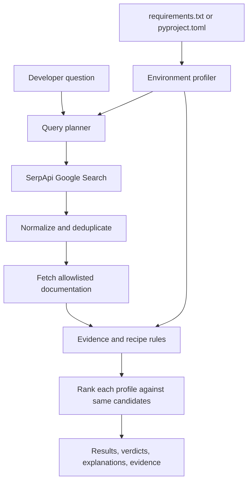

# VersionVerdict

**The right answer for your version.**

_Repository-aware developer search powered by SerpApi._

VersionVerdict searches for technical solutions, then checks a small set of recognized recipes against dependency versions declared in a Python project manifest.

**One query. Shared search results. Different environments. Different verdicts.**

**Demo video:** pending · **Screenshots:** pending

---

## The Problem

**A technically correct answer can still be wrong for your project.**

Developers search the web for errors, configuration problems, framework migrations, and unfamiliar APIs. Search results usually optimize for query relevance. They do not know which dependency versions a project declares.

For example, Pydantic V2 moved `BaseSettings` to the separate `pydantic-settings` package. That is a useful real-world version difference, but VersionVerdict's current rules do not evaluate `BaseSettings`. The working MVP demonstrates the same problem with a narrower, tested example: Pydantic's `parse_obj()` and `model_validate()` methods.

The relevance of advice can change across framework upgrades, deprecations, breaking API changes, and documentation for different releases. Developers need evidence that advice applies to their environment.

---

## The Solution

VersionVerdict accepts a technical question and one or two dependency manifests. It retrieves search results, checks a narrow set of recipes against declared versions, and ranks the same candidates for each environment.

| Verdict         | Meaning in this MVP                                                                                          |
| --------------- | ------------------------------------------------------------------------------------------------------------ |
| `COMPATIBLE`    | Reviewed evidence supports this recognized recipe for the declared version and selected context.             |
| `WRONG_VERSION` | Reviewed evidence says the recipe is unavailable in the declared version.                                    |
| `STALE`         | Evidence says the recipe is deprecated or superseded for the declared version.                               |
| `UNCERTAIN`     | Version, runtime context, source, or recipe evidence is missing, ambiguous, or outside tested rule coverage. |

A Google result or snippet alone cannot establish a definitive verdict. VersionVerdict does not use an LLM to decide factual compatibility.

---

## The Defining Demonstration

### Same question. Different dependency versions.

Ask: **“Validate a dictionary into a Pydantic model.”** Compare these manifests:

|                     | Project A                            | Project B                         |
| ------------------- | ------------------------------------ | --------------------------------- |
| Declared dependency | `pydantic==1.10.15`                  | `pydantic==2.9.2`                 |
| Top recipe          | `parse_obj()` — `COMPATIBLE`         | `model_validate()` — `COMPATIBLE` |
| Other recipe        | `model_validate()` — `WRONG_VERSION` | `parse_obj()` — `STALE`           |

The result cards include the recipe quote and a separate official migration fact. Pydantic V2 retains several old method names but deprecates them, so the MVP labels `parse_obj()` **STALE**, not removed.

The second example uses SQLAlchemy. For `SQLAlchemy==1.4.54` with future mode set to off, `Engine.execute()` is `STALE`. For `SQLAlchemy==2.0.36`, it is `WRONG_VERSION`. The replacement `Connection.execute()` ranks as compatible in both tested profiles.

These comparisons use the same candidate list for both profiles. The bundled search responses are **illustrative fixtures, not captured SerpApi responses**. Select **Live · SerpApi** to use live search after configuring the backend key and network access.

---

## How It Works



### 1. Environment profiling

The MVP accepts `requirements.txt` and `pyproject.toml`. It reads PEP 621 dependencies and a limited subset of Poetry dependency strings. It does not execute uploaded code.

The profiler distinguishes a single exact `==` pin from a range. It reports unsupported directives, markers without target context, direct URLs, and duplicate declarations. It reads **declared** dependencies; it does not inspect a virtual environment or claim to know installed versions. Profiles can contain up to two manifest files and 256 KiB total.

The applicability rules currently cover Pydantic 1.10 and 2.0–2.14, and SQLAlchemy 1.4 and 2.0. Other versions remain `UNCERTAIN`. For Pydantic, native API, `pydantic.v1` shim, or unknown namespace can be selected. For SQLAlchemy 1.4, future mode can be set to on, off, or unknown. Unknown context produces `UNCERTAIN` when a rule depends on it.

### 2. Search query planning

The query planner creates a bounded set of Google searches:

- Pydantic: the question with the library, plus Pydantic V1 and V2 official documentation searches.
- SQLAlchemy: the question with the library, plus a version-targeted official documentation search.

The MVP does not currently generate GitHub or Stack Overflow searches. Unsupported libraries are rejected. Recorded mode supports only the two documented demo questions.

### 3. SerpApi retrieval

The backend uses SerpApi's Google Search JSON endpoint, `https://serpapi.com/search.json`. Requests run asynchronously with concurrency limited to two, a 15-second timeout, and one retry for transport failures or server errors. Quota, authentication, and API errors are surfaced. Partial successful queries can still return candidates with warnings.

`SERPAPI_KEY` stays in the backend environment. It is never sent to the React app. Live search has not been verified in this cloud environment because credentials were absent and the network proxy blocked SerpApi requests. Do not treat the illustrative fixture as evidence of a live API call.

### 4. Evidence and applicability

Search results discover candidate pages. Live verdicts require matching recipe text in fetched page content and a separate, pinned official migration fact. The fetcher currently permits only `docs.pydantic.dev` and `docs.sqlalchemy.org`, disables redirects, limits source size, and uses a timeout. Other result hosts remain `UNCERTAIN`.

The rules distinguish deprecation from removal. For example, Pydantic V2 deprecates `parse_obj()`; SQLAlchemy 2.0 removes `Engine.execute()`. SQLAlchemy 1.4's `future=True` setting affects `Engine.execute()`, so the UI asks for that context.

Each evidence item shows its URL and quote. It also carries a content hash for inspection. A high search rank, snippet, or recent publication date does not increase factual certainty. No evidence or conflicting context produces `UNCERTAIN`.

### 5. Ranking

The current ranker orders categories as COMPATIBLE, UNCERTAIN, STALE, then WRONG_VERSION. It then uses evidence presence, original Google result position, and a stable result ID. It does not compute probabilistic confidence. The rule set recognizes only a small number of named APIs; unrelated results remain visible as `UNCERTAIN`.

---

## Why SerpApi?

SerpApi supplies live Google result discovery for the requested technical question and the planner's version-targeted queries. VersionVerdict uses returned titles, URLs, snippets, and positions to build a shared candidate set, then fetches permitted official documentation for evidence.

| SerpApi capability | Current use                                                                    |
| ------------------ | ------------------------------------------------------------------------------ |
| Google Search API  | Retrieves live organic results when credentials and network access work.       |
| Query parameters   | Sends the original and bounded version-targeted queries.                       |
| Structured JSON    | Supplies titles, links, snippets, and positions for normalization and ranking. |

**SerpApi discovers candidate sources. VersionVerdict checks whether its supported recipes apply to a declared environment.**

[SerpApi Search API documentation](https://serpapi.com/search-api)

---

## Technology Stack

| Layer              | Technology                          |
| ------------------ | ----------------------------------- |
| Frontend           | React, TypeScript, Vite             |
| Backend            | Python 3.12+, FastAPI, Pydantic     |
| HTTP               | httpx async client                  |
| Dependency parsing | `packaging`, Python `tomllib`       |
| Source extraction  | Beautiful Soup                      |
| Search             | SerpApi Google Search API           |
| Tests              | pytest, pytest-asyncio, HTTPX mocks |

One FastAPI service can serve the built React app. No database, account system, queue, or separate worker is required for this MVP.

---

## Getting Started

### Prerequisites

- Python 3.12+
- Node.js 22+ and npm
- A SerpApi account and API key for live search

From the repository root:

```bash
python3.12 -m venv .venv
.venv/bin/python -m pip install -r backend/requirements-lock.txt
npm --prefix frontend ci
```

### Run the application

For the API and built frontend in one service:

```bash
npm --prefix frontend run build
PYTHONPATH=backend .venv/bin/uvicorn app.main:app --host 127.0.0.1 --port 8000
```

Open `http://127.0.0.1:8000`. The API documentation is at `http://127.0.0.1:8000/docs`.

For frontend development, run the backend above and start Vite in another terminal:

```bash
npm --prefix frontend run dev
```

Open the local URL Vite prints, normally `http://localhost:5173`.

### Configure live search

Set `SERPAPI_KEY` in the backend process environment. `.env.example` documents the variable; the app does not load `.env` files automatically. For local Bash, enter the key without echoing it:

```bash
read -rsp 'SerpApi key: ' SERPAPI_KEY
export SERPAPI_KEY
printf '\n'
```

Then start or restart the backend. The deployment must allow HTTPS requests to `serpapi.com`, `docs.pydantic.dev`, and `docs.sqlalchemy.org`. Never put the key in a `VITE_*` variable or commit its value.

---

## Usage

1. Choose Pydantic or SQLAlchemy.
2. Upload a `requirements.txt` or `pyproject.toml` for Version A. Optionally upload another manifest as Version A's second file. Add Version B to compare two environments.
3. Enter a question. Select native or shim mode for Pydantic, or SQLAlchemy 1.4 future mode when relevant. Leave context unknown when you cannot confirm it.
4. Select **Live · SerpApi** for live retrieval or **Illustrative fixture · offline** for the bundled comparison example.
5. Submit and inspect each result's verdict, explanation, and evidence quotes.

The bundled comparison demo fills known context for reproducibility. It labels its results as illustrative. Recorded mode accepts the fixture's documented query for each library; it does not impersonate live SerpApi output.

---

## API

`POST /api/search` accepts multipart fields:

- `query`: 3–240 characters.
- `library`: `pydantic` or `sqlalchemy`.
- `mode`: `live` or `recorded`.
- `left_file`: Version A manifest; optional `left_extra_file`.
- `right_file`: optional Version B manifest; optional `right_extra_file` requires `right_file`.
- `pydantic_api_mode`: `native`, `v1_shim`, or `unknown`.
- `sqlalchemy_future`: `true`, `false`, or `unknown`.

Manifests must be named `requirements.txt` or `pyproject.toml`. Each profile accepts at most two files and 256 KiB combined.

`GET /api/health` returns service health and whether the key is present. It never returns the key value. Live mode returns an explicit error when the key is missing or SerpApi fails.

---

## Verification and Testing

Run from the repository root:

```bash
PYTHONPATH=backend .venv/bin/python -m pytest backend/tests -q
npm --prefix frontend run build
```

The last recorded local result was **11 passed, 1 skipped** for backend tests. The skipped test is the live SerpApi integration test; it skips without `SERPAPI_KEY`. The frontend TypeScript check and production build passed. The two dependency scenarios were also exercised with isolated Python 3.12 environments.

Run the live test after configuring credentials and network access:

```bash
PYTHONPATH=backend .venv/bin/python -m pytest backend/tests/test_live.py -q
```

The recorded search JSON is illustrative and not a SerpApi capture. The small fixtures validate the implemented rules, not broad search accuracy. No general benchmark score or live search success rate is claimed. See [evaluation notes](docs/evaluation.md).

---

## Limitations

- The app reads manifest declarations, not installed environments or repository source code.
- Version ranges and duplicate dependency declarations do not become exact versions.
- Applicability rules cover four API patterns in two libraries; unrelated results stay uncertain.
- Only two official documentation hosts are fetched for evidence.
- Search-result and source contents can change; the bundled result fixtures are illustrative.
- The app does not prove that a recipe works in a developer's application. Validate changes with the project's own tests.
- Live SerpApi access was not verified in the development cloud environment. No production deployment is included.

---

## Hackathon Submission

**Event:** SerpApi India Hackathon 2026

**Track:** Open Innovation — Developer Tools

- **Demo video:** pending
- **Source code:** this repository
- **Deployment:** not yet published
- **Contributors:** Ananay Srivastava
- **AI-assisted development:** Codex was used to plan and implement the MVP; tests and version-specific package behavior were checked in isolated environments.
- **License:** not specified yet

Verify current registration, eligibility, submission fields, and event rules on the [official hackathon site](https://serpapi.github.io/serpapi-india-hackathon-2026/) before submitting.

---

**VersionVerdict — The right answer for your version.**

_Search relevance is not the same as software compatibility._
